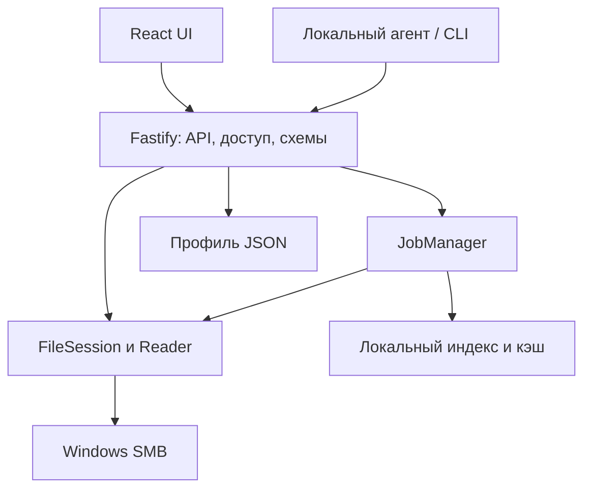

# APlog Viewer — отчет по плану и архитектуре

13 ноября 2026 · Технический отчет · Исходник: приложенный task.md

> **Вердикт: базовая архитектура подходит.** Локальный Node.js/Fastify backend, React и чтение SMB через Windows - разумная основа для однопользовательского просмотрщика. План пока нельзя считать готовым техническим заданием: не определены правила актуальности данных, границы поиска и условия измерения производительности.

### Что можно оставить

Позиционное чтение небольшими окнами, виртуализацию интерфейса, фоновый разреженный индекс, локальный профиль JSON и единый API для UI и будущего агента. Переписывать backend на другой язык, вводить микросервисы, поисковый кластер или обязательную БД сейчас оснований нет.

### Что исправить до основной реализации

**1.** Разделить путь, идентичность файла и поколение его содержимого. **2.** Описать ротацию, truncate и переподключение tail. **3.** Выбрать семантику и безопасное исполнение regex. **4.** Включить защиту локального API уже в MVP.

| Приоритет | Сколько | Когда закрыть |
| --- | --- | --- |
| P0 | 4 | До закрепления модели данных и API |
| P1 | 10 | До приемки MVP |
| P2 | 2 | До завершения поставки и передачи проекта |

### Что именно проверено

Проведен анализ одного планового документа, сверка ключевых допущений с первичной документацией и три локальных алгоритмических контрпримера. Исходный код, рабочая Windows-машина, реальные логи и SMB-сервер не предоставлены. Поэтому отчет оценивает проектные решения; он не подтверждает наличие дефектов в реализации или достижение заявленных SLA.

## Реестр замечаний

P0 - решение влияет на корректность или границу доступа; P1 - существенно для функциональности и надежности; P2 - завершенность поставки. Это приоритет исправления плана, а не оценка обнаруженных уязвимостей работающего приложения. Ссылки на строки относятся к приложенному task.md.

| ID / приоритет | Место | Замечание и требуемое изменение |
| --- | --- | --- |
| F01 / P0 | 20-21, 96-98 | dev:ino не описывает версию содержимого. Нужны namespace, generation и политика проверки кэша. |
| F02 / P0 | 24-25, 69-70, 101 | Tail по одному mtime не определяет append/replace/truncate. Нужна модель переходов и разрывов. |
| F03 / P1 | 18-21, 65, 92-95 | Байтовая навигация и точный номер строки имеют разные требования к сканированию. |
| F04 / P1 | 34-35, 63-64 | Не заданы границы символов/строк, UTF-16, длинные строки и неопределенность кодировки. |
| F05 / P0 | 26-29, 71-74 | Произвольный regex не становится корректным и отменяемым только из-за чтения чанками. |
| F06 / P1 | 30-31, 73-74 | Скрытие строк окна не равно фильтрации всего файла; экспорту нужен фиксированный диапазон. |
| F07 / P1 | 18, 47-50, 88-95 | Нет лимитов фоновых задач, памяти и поведения при зависшем SMB I/O. |
| F08 / P1 | 18-19, 24-27 | 300 мс, 2 с и 5 с не привязаны к стенду, кешам и точке измерения. |
| F09 / P0 | 105-106 | Loopback не заменяет защиту HTTP API. Нужны токен, Host/Origin и ограничение путей. |
| F10 / P1 | 38-39, 79-80, 107-108 | Флаг профиля не отключает запуск задачи Windows. Не задан контекст учетной записи. |
| F11 / P1 | 32-33, 75-76 | Обычная вкладка браузера не гарантирует восстановление геометрии окна. |
| F12 / P1 | 36-37, 77-78, 103-104 | API проектируется слишком поздно; отсутствует семантика курсоров, версий, ошибок и задач. |
| F13 / P1 | 36-37, 133-134 | Агрегаты требуют парсера событий, но структурированный источник вынесен за MVP. |
| F14 / P1 | 50, 69-72 | SSE не дает автоматической гарантии воспроизведения событий и ограничения очереди. |
| F15 / P2 | 22-23, 32-33, 99-100 | Не описаны восстановление профиля, конфликт записей и переполнение закрепленного кэша. |
| F16 / P2 | 61-82, 111-129 | Нет сценария production-запуска и воспроизводимых доказательств; «непроверено: нет» преждевременно. |

## Идентичность, ротация и tail

### F01 / P0. Кэш не равен версии файла

**Основание:** «Решения», строки 96-98.

Сохранение NTFS File ID при обычном rename - корректное допущение для этого случая. Но этот ID не удостоверяет неизменность байтов: truncate и перезапись могут оставить тот же файловый объект. Windows также допускает повторное использование ID после удаления; FILE_ID_INFO идентифицирует объект в пределах компьютера, а не всей сети [S2], [S3].

**Поправить:** Ввести **sourceId** (логический источник), **identity** (namespace сервера/ресурса + доступные volume/file ID) и **generation** (эпоха содержимого). Проверить значения Node Stats на целевом SMB; для ID использовать bigint при чтении и строки при сериализации. В manifest индекса хранить generation, scannedBytes, кодировку/правила разделения строк и версию формата. При сомнении перестраивать индекс.

**Приемка:** Rename сохраняет применимый индекс старого файла; truncate, замена по тому же пути и смена трактовки строк сбрасывают затронутые результаты. Проверяется отдельно от совпадения ID.

**Недостаточность fallback:** path+size+mtime и первые/последние 4 КиБ - эвристика. Изменение середины может оставить эти признаки прежними. Такой ключ нельзя использовать как доказательство корректности номеров строк. Требуется договоренность «только дописывание до ротации» либо явно ослабленная гарантия, либо полная проверка содержимого.

### F02 / P0. У tail должен быть явный жизненный цикл

Polling как базовый подход оправдан: Node предупреждает об ограничениях fs.watch на SMB [S1]. Однако mtime не является надежным единственным сигналом: Windows не гарантирует своевременное обновление времени записи при открытом записывающем handle [S4]. Проверять нужно размер, идентичность и доступность; чтение новых байтов не должно зависеть исключительно от изменения mtime.

| Событие | Рекомендуемое поведение |
| --- | --- |
| Append | Дочитать от курсора, сохранить незавершенный символ и строку. |
| Rename + новый файл | По умолчанию следовать пути; старый handle можно дочитать по ограниченной политике. Затем новый generation и событие rotated. |
| Truncate / copytruncate | Сброс курсора и индекса поколения, событие truncated. Гарантировать отсутствие потерь между опросами нельзя. |
| Обрыв / отказ доступа | Состояние disconnected/access_denied, повтор с задержкой, перепроверка identity после восстановления. |

**Граница обещания:** viewer не может восстановить байты, уже удаленные writer-ом до чтения. Ротация без потерь требует совместимого поведения самого логгера. Для вкладки явно выбрать follow-path или follow-handle; новые строки не должны самовольно переключать активную вкладку.

## Байтовая навигация и кодировки

### F03 / P1. Разреженный индекс не устраняет первый скан

**Основание:** критерии 18-21; шаги 3-4; строки 92-95.

Открыть окно около произвольного byte offset без прохода от начала возможно. Узнать точный номер строки в этом окне до подсчета предшествующих переводов строк в общем случае невозможно. Разреженный индекс ускоряет повторные обращения, но сам строится сканированием. Шаг UI со «счетчиком строк» раньше индекса требует состояния «еще неизвестно».

**Поправить:** Возвращать indexedThroughByte, indexedThroughLine и indexComplete. Вне проиндексированного префикса показывать неизвестный номер, а переход к строке N выполнять отменяемой задачей. До завершения скана не подменять оценку точным totalLines.

**Приемка:** В новом файле 1 ГБ переход по байтам работает сразу; запрос строки вне индекса показывает прогресс. После полного скана номера совпадают с эталоном.

Интервал «каждые N строк» ограничивает число дочитываемых строк, но не число байтов: одна строка может иметь размер в мегабайты. Добавить лимит байтового окна и частичный показ длинной строки. Байт-scrollbar означает долю исходного файла, а не точную долю строк; при wrap высота строк переменная. Для MVP проще выключить wrap по умолчанию, сохраняя якорь по byte offset.

### F04 / P1. Декодер и разделитель строк - часть ядра

**Основание:** кодировки, строки 34-35; reader.ts.

Начало окна может попасть в середину UTF-8 символа, UTF-16 code unit или пары CRLF. Независимое buffer.toString для каждого чанка может повредить текст. Потоковый декодер сохраняет незавершенные многобайтные последовательности, но случайный seek требует отдельного выравнивания [S9].

**Поправить:** Задать LF/CRLF и поведение CR, BOM, пустого файла и последней строки без перевода. Для BOM явно поддержать UTF-8 и UTF-16LE/BE либо вернуть понятный отказ [S10]. Хранить byteStart/byteEnd по исходным байтам, а не индексам JS-строки; части очень длинной строки маркировать. Установить лимиты строки и допустимое поведение поиска сверх лимита.

**Приемка:** Кириллица и emoji на границах чанков не портятся; случайный seek, tail и поиск возвращают одинаковые байтовые координаты.

> **Автоопределение - предположение, а не гарантия.** Валидность UTF-8 на выборке не проверяет весь файл; ASCII одинаково допустим в нескольких кодировках. cp1251 и cp866 без внешней информации неоднозначны. Показать выбранную кодировку и основание выбора; дать ручной override и настройку fallback. Смена кодировки инвалидирует зависимые декодированные результаты. Для нового поколения файла автоматически перепроверять BOM.

## Поиск, правила и фильтры

### F05 / P0. Сначала определить, что означает regex

**Основание:** критерии 26-29; search.ts и rules/engine.ts.

«По всему файлу» не уточняет, разрешены ли совпадения через перевод строки. Наивный поиск по независимым чанкам пропускает совпадения на стыках. Для произвольного regex фиксированный overlap не обеспечивает полноту. Некоторые выражения в JavaScript могут надолго занять event loop; отмена между чанками не прервет уже выполняющийся RegExp [S7].

**Поправить:** Для MVP предложен **построчный regex**, применяемый ко всем строкам заданного диапазона. Поддержку multiline/stack trace перенести в явную отдельную задачу. Выбрать RE2-совместимый движок с документированными ограничениями либо изолированный JS worker с принудительным завершением по бюджету. RE2 не поддерживает look-around и backreferences [S8]; выбор движка нужно проверить на Windows и закрепить до написания правил.

**Приемка:** Совпадение на стыке чанков находится ровно один раз; опасный паттерн не замораживает UI/API; timeout/cancel дают явный статус, а не «совпадений нет».

Поиск назад проще выполнять чтением блоков с конца, сборкой полных строк и обычным сопоставлением внутри каждой строки. Внутри строки выбрать последнее подходящее совпадение до курсора. Уточнить включение текущего совпадения, переход через начало/конец, zero-length matches и режим учета регистра. Один движок и одинаковые правила нужны для поиска, фильтра и подсветки; исполнять небезопасный regex в UI-потоке нельзя.

### F06 / P1. Фильтрация меняет модель прокрутки

**Основание:** критерии 30-31; шаг 7.

Если скрывать строки только загруженного окна, пустой экран не означает отсутствие совпадений дальше. Точное количество видимых строк и переход к N-й отфильтрованной строке требуют отдельного скана/индекса результатов. Это другой индекс, зависящий от фильтра и generation.

**Поправить:** Для MVP оставить навигацию по исходным байтам и «следующие/предыдущие подходящие строки» с признаком неполного просмотра. Фиксировать правила фильтра на время задачи. Поиск и экспорт привязывать к generation и верхней границе endByte; добавленные позднее данные не включать. При обнаруженном truncate/replace завершать с source_changed. Фиксированная длина не создает настоящего снимка при произвольной перезаписи.

**Приемка:** Экспорт совпадает с результатом независимого эталонного фильтра для того же диапазона; отмена и смена источника явно помечают неполный результат.

> **Предлагаемая семантика правил:** visible = (нет активных include ИЛИ совпал хотя бы один include) И НЕ(совпал хотя бы один exclude). Exclude имеет приоритет. Для подсветки - первое совпавшее активное правило по приоритету; при равенстве порядок в профиле. Инверсия действует на результат одного правила. Экспортировать текст потоком, по умолчанию UTF-8, с явно выбранными переводами строк.

## Ресурсы и измеримые обещания

### F07 / P1. Нужен общий бюджет операций

**Основание:** лимит RSS; reader/search/tail/index-cache.

Окно в 256 КиБ не ограничивает суммарную память. Буферы поиска, строки JavaScript, JSON-ответы, очереди SSE и накопленные результаты могут многократно превысить окно. Async fs не блокирует JS-поток напрямую, но зависшие операции могут занимать общий пул libuv; его разделяют event loops процесса [S11].

**Поправить:** Ввести JobManager и глобальные лимиты. Начальная конфигурация: одна фоновая сканирующая задача на SMB-источник, ограниченный CPU worker pool, приоритет окна и tail перед индексом/экспортом. Не накапливать все совпадения и весь tail в RAM. На старте проверить задержки I/O; если требуется независимая живучесть при зависшей шаре, вынести SMB I/O в перезапускаемый helper process. CPU worker сам по себе не изолирует общий fs pool.

**Приемка:** Одновременные просмотр, поиск, индексация и обрыв SMB не делают локальный health/UI недоступным и не вызывают неограниченный рост числа задач, handles и памяти.

**Отмена и тайм-аут:** прекращение ожидания Promise не останавливает системный вызов. Даже AbortSignal у readFile отменяет внутреннюю обработку, а не каждый запрос ОС [S1]. Для FileHandle.read нужен собственный жизненный цикл: запрет новых чтений после отмены, игнорирование поздних результатов, закрытие после завершения I/O. Время подтверждения отмены и время освобождения зависшего ресурса измерять отдельно.

### F08 / P1. Заявленные числа пока не являются SLA

| Обещание | Что в нем не определено |
| --- | --- |
| 30 МБ за 300 мс | Первое видимое окно или прочтение всех 30 МБ? Холодный запуск браузера, SMB-аутентификация и пустой кэш входят во время? |
| 100 МБ за 5 с | Отсутствующее совпадение или первый хит? Какой regex, кодировка, число результатов и скорость сети? |
| Tail за 2 с | Запись в буфер приложения, flush writer-а, видимость на SMB-клиенте или DOM-отрисовка? Есть ли нагрузка/обрыв? |
| RSS < 300 МБ | Один backend или все дочерние процессы? Сколько вкладок и задач? Учитывается ли браузер отдельно? |

**Расчет нижней границы:** 100 МБ за 5 с требует минимум 20 МБ/с полезного последовательного чтения. На канале 100 Мбит/с идеальная передача 100 МБ занимает 8 с, а 30 МБ - 2,4 с, еще до SMB и декодирования. Поэтому 300 мс имеет смысл как время первого окна, а не полного чтения. Здесь МБ = 10⁶ байт; это расчет, не замер.

**Предлагаемый стенд:** Windows и точные версии Node/npm/browser, тип SMB-сервера/ФС, RTT и фактическая скорость; отдельно пустой кэш индекса и повторное открытие, отдельно состояние ОС/SMB-кэшей. Для p95 - минимум 30 повторов; для памяти - 1 ГБ, 3 вкладки, один поиск и tail. Считать память всей группы backend-процессов; браузер измерять отдельно. Числа утверждать только после пробного чтения на целевой шаре.

## Локальный доступ и Windows

### F09 / P0. Защита нужна и на loopback

**Основание:** строки 105-106.

127.0.0.1 исключает обычный вход с другой машины, но не является авторизацией. Локальные процессы могут обратиться к API; взаимодействие веб-страниц с локальными сервисами зависит от браузерных защит. Отсутствие CORS-разрешения само по себе не заменяет защиту от нежелательных запросов. Host-проверка применяется, например, в Node Inspector против DNS rebinding [S12].

**Поправить:** С первого релиза: bind только 127.0.0.1; точный allowlist Host и проверка Origin для браузерных запросов; непредсказуемый локальный токен/сессия; защита изменений профиля, источников и экспорта. Не разрешать произвольный CORS. Зарегистрированные источники выдавать через opaque fileId и проверять разрешенные корни. Рендерить логи как текст, ограничивать размеры запросов и число правил. Защиту CSRF выбрать под способ сессии [S13].

**Приемка:** Посторонние Host/Origin, запрос без токена, выход за разрешенный корень и HTML в логе не дают доступа/исполнения. Авторизованный CLI-агент работает без браузерного Origin.

Пароль вводить пользователю необязательно: launcher может выдать одноразовый bootstrap и создать сессию. Токены не передавать в query string и не писать в логи. Для SSE с Bearer-заголовком использовать fetch-stream; нативный EventSource не предоставляет произвольные заголовки, тогда нужна соответствующая cookie-сессия [S14]. Это защита от посторонних запросов, не изоляция от вредоносного процесса с полными правами того же пользователя.

### F10 / P1. Автозапуск должен сохранять SMB-контекст

**Основание:** строки 38-39, 79-80, 107-108.

Успешное ручное чтение шары не доказывает доступ из Task Scheduler. S4U не имеет доступа к сети; интерактивный токен работает в уже открытой сессии пользователя [S5]. Флаг внутри приложения проверяется только после запуска и не удовлетворяет буквальному критерию «не стартует само».

**Поправить:** Для данного локального UI использовать триггер входа текущего пользователя и интерактивный контекст без ненужного повышения прав. Отключение должно реально disable/delete задачу Windows; профиль отражает фактическое состояние. Задать абсолютные пути, working directory, single-instance и задержанный повтор при недоступной сети.

**Приемка:** Вход в Windows действительно запускает приложение и читает UNC под тем же пользователем; после disable повторный вход его не запускает. Одного schtasks /query недостаточно.

### F11 / P1. Уточнить, какая «геометрия» сохраняется

Панели, шрифт, wrap и позицию просмотра сохранить можно. Восстановить размер и координаты обычного окна браузера из страницы гарантировать нельзя: CSSOM ограничивает resize/move и допускает отказ браузера [S6]. **Рекомендация:** в MVP обещать геометрию внутренних панелей. Если требуется точная геометрия OS-окна, отдельно выбрать управляемый launcher/native shell и пересмотреть стоимость поставки.

## Контракт, события и состояние

### F12 / P1. API нужно спроектировать до reader и UI

Шаг 9 сейчас оставляет на конец определения, которые нужны уже шагу 2. OpenAPI проверяет форму данных, но не гарантирует стабильность смысла. Сразу закрепить byte offsets, поколения, частичные строки, курсоры, пределы окна и ошибки. Схемы запросов и ответов использовать для runtime-валидации; TypeScript типы сами по себе не проверяют внешние данные. Проект контракта приведен ниже.

### F13 / P1. Агрегаты требуют отдельного разбора событий

Для произвольного текстового файла нельзя достоверно извлечь уровень, источник и время без правил парсинга. «Строка» и «событие» различаются при stack trace. Нужно задать формат времени и часовой пояс, объединение продолжений, unknown-значения, parserVersion, долю разобранных записей и диапазон покрытия. Нераспознанную запись нельзя автоматически считать INFO. Полные агрегаты тоже требуют прохода по выбранному диапазону.

**Два допустимых решения:** перенести /stats в следующую фазу с явным изменением критерия MVP; либо включить в MVP один конкретный парсер с примерами реальных логов и проверенными ожидаемыми агрегатами. Упоминание NDJSON в follow-up само по себе эту зависимость не закрывает. Обобщенная «ML-готовность» не проверяема: нужен конкретный сценарий потребителя, сырые байты/текст, provenance и воспроизводимый диапазон чтения.

### F14 / P1. SSE требует политики восстановления

EventSource умеет переподключаться и передавать Last-Event-ID [S14], но хранение событий, обнаружение пропусков и дедупликацию должен реализовать сервер/клиент. Рекомендуется один мультиплексированный канал на сессию: fileId, generation, eventId и byte cursor. При переполнении ограниченной очереди отправлять resync_required и перечитывать окно. После restart или несовместимого generation выполнять resync, не обещать бесконечный replay. Heartbeat и закрытие подписки должны освобождать ресурсы.

### F15 / P2. Долговечный профиль отделить от кэша

Профиль - пользовательские настройки; индекс - восстанавливаемые данные. Хранить их раздельно, кэш локально, а не рядом с удаленным логом. Запись профиля: schemaVersion, валидация, очередь одного writer-а, временный файл в том же каталоге, flush/replace и резервная предыдущая версия. Проверить сбой в момент записи и занятый файл на Windows. Две вкладки браузера требуют revision/conflict или явной политики последней записи.

GC должен считать возраст по lastUsed, а не по дате создания; закреплять индексы и за вкладками, и за активными задачами. Если закрепленные данные уже превышают лимит, жесткий предел и запрет удаления несовместимы. Предложение: soft limit с индикатором и остановкой создания новых кэшей; строгий лимит потребует иной политики. Кэш не должен дублироваться на каждую UI-вкладку.

### F16 / P2. Дописать поставку и доказательства

Нужны production build и запуск без Vite dev server: Fastify раздает собранный UI и API с одного origin. Определить start/stop, занятый порт, повторный запуск, открытие браузера после readiness, работу после закрытия вкладки, логи самого приложения и обновление профиля. Зафиксировать точные версии и lockfile. В Handoff заменить «непроверено: нет» списком открытых гипотез; ручное чтение UNC и версии среды отмечены автором плана, в этом ревью повторно не проверялись.

## Предлагаемая архитектура

Сохранить модульный монолит. HTTP-слой управляет доступом и контрактом; единое файловое ядро определяет, какие байты и строки видят все функции. Фоновое исполнение ограничено ресурсными бюджетами. Это уточнение текущего стека, а не полная смена архитектуры.



| Модуль | Ответственность / что добавить к плану |
| --- | --- |
| packages/contracts | Схемы API, ошибки и события; shared типы, генерация OpenAPI и contract tests. |
| files/session.ts | Открытый handle, path/identity/generation, смена файла, курсоры и лимиты. |
| files/decoder.ts + lines.ts | Единые кодировки, разделители строк, неполные записи и байтовые координаты. |
| jobs/manager.ts | Приоритеты, отмена, CPU/I/O бюджеты, пагинация результатов и тайм-ауты. |
| index + profile stores | Раздельные manifest/индекс/профиль; GC, версии, восстановление после сбоя. |
| api + security + events | Auth, allowlist путей, runtime validation, SSE resync и обработка ошибок. |

**Общий путь данных:** source → byte reader → decoder/line framing → matcher → окно, поиск или экспорт. UI не должен повторно интерпретировать фильтры другим движком. Парсер событий для /stats подключается после формирования строк и версионируется отдельно.

**Worker boundaries:** тяжелое сопоставление/разбор выполнять вне основного JS-потока. Отдельный процесс для SMB - решение по результатам испытания отключения сети, а не обязательный второй сервис. При строгом требовании изоляции зависших операций его следует выбрать сразу.

## Проект API v1 и модели чтения

Ниже - предлагаемый контракт, а не описание уже реализованных endpoint-ов. Все операции чтения используют зарегистрированный fileId; исходный путь задается только при регистрации источника. Версия протокола и generation содержимого - разные понятия.

| Операция | Предлагаемая форма и семантика |
| --- | --- |
| Источники | POST /api/v1/files - зарегистрировать разрешенный UNC; GET /files - только известные источники; DELETE /files/{id} - закрыть регистрацию. Не удаляет лог. |
| Окно | GET /files/{id}/window?offset=…&maxBytes=…&maxLines=…; возвращает границы, partial flags, generation и состояние индекса. |
| Поиск | POST /searches - создать ограниченную задачу; GET /searches/{id}/results?cursor=…; DELETE /searches/{id} - идемпотентная отмена. |
| Фильтр / экспорт | POST /exports фиксирует fileId, generation, endByte и rulesRevision; результат - поток или локальный временный файл с ограниченным сроком хранения. |
| События | GET /events - единый SSE поток: append, rotated, truncated, progress, disconnected, resync_required. REST остается путем повторного чтения. |
| Индекс / статистика | Состояние индекса - в метаданных файла. /stats включать только с согласованным парсером и явными границами покрытия. |

### Минимальный ответ окна

```json
{
  "fileId": "opaque-id", "generation": "opaque-generation",
  "observedSize": "1073741824",
  "range": {"startByte": "1048576", "endByte": "1048704"},
  "lines": [{
    "byteStart": "1048576", "byteEnd": "1048704",
    "lineNumber": null, "text": "...",
    "partialStart": false, "partialEnd": true
  }],
  "index": {"scannedBytes": "524288", "complete": false},
  "nextCursor": "opaque-cursor"
}
```

Пример условный: диапазон полуоткрытый [startByte, endByte), координаты считаются от начала исходного файла. Десятичные строки позволяют не терять точность больших ID/offsets в JSON. Для строки byteEnd включает терминатор, если он прочитан; text терминатор не включает. lineNumber задается с 1 или null, если точный номер пока неизвестен. Размер строки и ответа ограничиваются отдельно.

> **Согласованность:** поиск/экспорт фиксирует generation, endByte, encodingRevision и rulesRevision. При append диапазон не расширяется. При выявленной несовместимой смене содержимого - SOURCE_CHANGED (например, HTTP 409) и новый курсор. Это диапазон append-only файла, не транзакционный снимок произвольно изменяемого файла.

Машинные коды ошибок: ACCESS_DENIED, SOURCE_UNAVAILABLE, SOURCE_CHANGED, INVALID_ENCODING, INVALID_REGEX, LIMIT_EXCEEDED, CANCELLED. Сообщения UI - русские. Прогресс: scannedBytes/targetBytes и состояние queued/running/cancelling/done; уведомления не заменяют доступное по REST состояние задачи.

## Предлагаемые критерии приемки

Это редакция требований для согласования. Она уточняет исходные обязательства; отмеченные переносы функций являются изменением объема MVP. Целевые времена сохраняются как гипотезы до измерения на реальном стенде.

| № | Формулировка для плана |
| --- | --- |
| AC1 | На зафиксированном стенде после готовности backend первое окно файла 30 МБ появляется за p95 ≤300 мс. Запуск браузера и первая SMB-аутентификация измеряются отдельно. |
| AC2 | Файл 1 ГБ открывается позиционным чтением без полного предварительного скана. Память группы backend-процессов <300 МБ при 3 вкладках, одном поиске и tail; браузер учитывается отдельно. |
| AC3 | Точные номера строк выдаются только для проиндексированного префикса. Переход к N за его пределами запускает отменяемую индексацию; UI показывает покрытие. |
| AC4 | Rename, replace, truncate и reconnect имеют отдельные сценарии. Кэш проверяется по identity + generation + формату; сомнительный индекс сбрасывается. Copytruncate не обещает восстановление уже потерянных байтов. |
| AC5 | В нормальном доступном SMB-режиме завершенная строка видна за p95 ≤2 с от ее доступности читающему клиенту. Интервал polling имеет запас на I/O; writer flush и максимальное отклонение фиксируются в evidence. |
| AC6 | Поиск по всем строкам фиксированного диапазона 100 МБ: ≤5 с на согласованном корпусе и стенде. Regex построчный, диалект объявлен; длинные/неподдерживаемые случаи дают явный статус. Отмена подтверждается ≤500 мс при нормальном I/O. |
| AC7 | Смена UTF-8/cp1251/cp866 и BOM UTF-16 обрабатывается по объявленной политике; стыки символов/CRLF/чанков и последняя неполная строка покрыты эталонными тестами. |
| AC8 | Фильтры имеют однозначную include/exclude семантику. Экспорт фиксирует диапазон и версию правил, выполняется потоком; отмененный/неполный результат явно помечается. |
| AC9 | Профиль восстанавливает вкладки, правила, кодировки, внутренние панели и byte anchor. Недоступный файл не ломает восстановление остальных. Геометрия OS-окна исключается из browser-MVP. |
| AC10 | API защищен локальной сессией/токеном с первого релиза; проверяются Host/Origin, права на источники, лимиты и безопасный вывод содержимого. SSE имеет resync при потере истории. |
| AC11 | Автозапуск проверяется реальным входом пользователя, доступом к UNC и отсутствием запуска после disable. Production работает без Vite. /stats либо имеет один проверенный парсер, либо исключен из MVP отдельным решением. |

Для AC1/AC5 выбрана p95, а не исходная безусловная верхняя граница. Это осознанное предложение изменить метрику. Если исходный максимум обязателен, нужно определить допустимые условия и подтвердить именно максимум на том же стенде; нельзя объявлять p95 эквивалентом максимума.

## Рекомендуемый порядок реализации

Исходный порядок стоит изменить: проектирование API и проверка Windows/SMB должны предшествовать полноценному UI. Защита доступа включается с первой рабочей версии API.

| Этап | Содержание | Условие перехода дальше |
| --- | --- | --- |
| 0. Проверка ключевых допущений | На реальной Windows/SMB-шаре проверить positional read, identity, concurrent write, rename, truncate, сетевой обрыв и доступ из Task Scheduler. Измерить первое окно и последовательное чтение. | Известны поддерживаемые сценарии ротации, ограничения I/O и реалистичные показатели. |
| 1. Контракт и модель | Source/FileSession/generation, byte ranges, ошибки, задачи, политика regex, авторизация и разрешенные пути. Общие схемы server/web. | Нельзя случайно использовать курсор или индекс от другого поколения. |
| 2. Файловое ядро | Декодер, разделитель строк, чтение вперед/назад, длинные и неполные строки. Минимальный профиль. | Эталонные тесты координат и текста проходят для всех заявленных кодировок. |
| 3. Просмотр и индекс | Виртуальное окно, byte scrollbar, фоновый индекс, неизвестные номера строк, manifest и GC. | 1 ГБ открывается без предварительного полного скана; индекс не мешает просмотру. |
| 4. Tail и события | Append/rotate/truncate/disconnect, единый SSE, resync и ограниченные очереди. | Проверены переподключение, смена поколения и отсутствие бесконечного накопления данных. |
| 5. Поиск и фильтры | Общий matcher, worker pool, отмена, поиск назад, экспорт фиксированного диапазона. | Результаты совпадают с эталоном; regex не блокирует API/UI. |
| 6. Завершение MVP | Полный профиль и миграции, production build, single-instance, автозапуск, нагрузочные и системные сценарии. | Evidence содержит реальные команды, версии, результаты и ограничения. |

**Решения об объеме MVP:** рекомендуется отложить точную геометрию OS-окна, произвольный многострочный regex и обобщенную аналитику для ML. `/stats` либо переносится явно, либо получает один конкретный парсер уже в MVP. Это предложения изменить объем, а не утверждение, что исходные требования выполнены.

## Матрица обязательных проверок

| Сценарий | Что подтверждает успешный результат |
| --- | --- |
| UTF-8, cp1251, cp866; BOM UTF-16LE/BE по принятой политике | Текст и byte offsets совпадают с эталоном; ручной override сохраняется. |
| Seek внутрь UTF-8 символа, UTF-16, CRLF; пустой файл; EOF без перевода | Нет поврежденных символов, потери строк и ошибочных координат. |
| Строка больше окна и установленного лимита | Память ограничена; частичность/ограничение явно показаны. Поиск не выдает неполный результат за полный. |
| Индекс отсутствует или построен частично | UI не показывает выдуманные точные номера строк; переход к N отменяем. |
| Rename + новый файл, replace, truncate, copytruncate | Правильный generation, курсор и сброс зависимых результатов. Не обещается восстановление уже удаленных байтов. |
| Изменение середины при тех же размере и краевых отпечатках | Эвристический fingerprint не принимается за доказательство неизменности. Проверяется выбранная политика append-only/инвалидации. |
| Regex на стыке чанков, назад, zero-length, тяжелое несовпадение | Полнота в заявленной семантике, отсутствие дублей и зависания, явный timeout/cancel. |
| Include/exclude и потоковый экспорт | Результат равен независимому эталону для одинакового диапазона и версии правил. |
| Изменение источника во время поиска/экспорта | Append не расширяет зафиксированный диапазон; выявленная несовместимая смена дает SOURCE_CHANGED. |
| Разрыв SMB, отказ доступа, блокировка writer-ом | UI остается управляемым; число повторов и ресурсов ограничено; после восстановления источник перепроверяется. |
| Медленный SSE-клиент, reconnect, истекшая история | Ограниченная очередь; resync вместо тихого пропуска или бесконечного replay. |
| Несколько вкладок + поиск + индекс + tail | Проверены лимит памяти всей группы backend, отзывчивость и отсутствие роста handles. |
| Сбой записи профиля, старая версия, две браузерные вкладки | Восстанавливается валидный профиль; миграция проверена; политика конфликтов явная. |
| Посторонний Host/Origin, отсутствие токена, выход за разрешенный путь, HTML в логе | Доступ отклоняется; содержимое лога не исполняется как HTML/JS. |
| Вход в Windows, disable, повторный запуск, занятый порт | Верный контекст UNC, один экземпляр, понятная ошибка; выключенный автозапуск реально не стартует. |
| Performance: cold/warm, первое окно, полный поиск, tail | В evidence указаны стенд, данные, кеши, повторения, p95/максимум, память и ограничения. |

### Что проверено непосредственно при подготовке отчета

Выполнены небольшие алгоритмические контрпримеры в локальной среде. Они проверяют недостаточность допущений, **не являются тестами APlog Viewer, Windows или SMB**.

| Контрпример | Результат |
| --- | --- |
| Два массива по 16 КиБ: первые и последние 4 КиБ одинаковы; внутри один байт заменен на LF | Размер и SHA-256 краевых блоков совпали, количество LF различается: 0 и 1. Следовательно, краевой fingerprint не удостоверяет применимость индекса строк. |
| `BEGIN` + 180 символов `x` + `END`; regex `BEGIN.*END`; чанки по 64 символа с перекрытием 16 | Поиск по целой строке находит совпадение; поиск по таким чанкам — нет. Конкретный контрпример фиксированному overlap. |
| UTF-8 строка `Привет`, разрез после первого байта, независимое декодирование частей с заменой ошибок | Результат отличается от исходной строки. Требуются потоковое декодирование и выравнивание при seek. |

Размеры в этих примерах: КиБ = 1024 байта. Расчеты пропускной способности выше используют десятичные МБ. Бенчмарки самого приложения не выполнялись.

## Точные изменения исходного task.md

1. **«Решения», `dev:ino`:** заменить обещание универсальной устойчивости к ночной ротации на проверяемую модель source/identity/generation и перечень поддерживаемых типов ротации.
2. **«Решения», polling:** заменить единственную проверку `mtime` на проверку размера, идентичности и доступности с чтением от курсора; добавить состояние разрыва и политику восстановления.
3. **Acceptance Criteria, номера строк:** уточнить, что точные номера известны только в проиндексированном диапазоне; первоначальный полный индекс требует фонового скана.
4. **Acceptance Criteria, поиск:** указать диалект regex, построчность/многострочность, границы диапазона, лимиты, семантику отмены и ошибок.
5. **Acceptance Criteria, производительность:** определить первое окно, стенд, кеши, число вкладок, границы учета памяти и статистику задержек.
6. **Acceptance Criteria, профиль:** разделить внутреннюю геометрию UI и геометрию окна браузера; вторую убрать из обязательств browser-MVP либо выбрать native shell.
7. **API:** перенести проектирование контракта в начало; `/stats` обеспечить парсером или явно перенести за MVP.
8. **Автозапуск:** реально отключать задачу ОС, а не только выходить после проверки флага; закрепить интерактивный контекст пользователя.
9. **Handoff:** вместо «Непроверено / внешний блокер: нет» перечислить SMB identity/rotation, блокировки writer-а, сеть, Task Scheduler и производительность как неподтвержденные гипотезы.
10. **Evidence:** скриншоты оставить для визуальной приемки; корректность чтения, ротации, экспорта и ограничения ресурсов подтверждать воспроизводимыми сценариями и эталонными результатами.

## Источники и границы выводов

Исходный материал — приложенный `task.md`, 138 строк. Нумерация строк в реестре относится к этой копии. Указанные в плане «проверено чтением» и «Node.js 26 и npm 11 проверены» приняты как заявления автора; доступа к той машине для перепроверки не было.

Документация проверена 13 ноября 2026 года. Ниже перечислены первичные источники. Предложения по архитектуре, приоритеты и новая редакция критериев — выводы этого ревью, а не требования поставщиков платформ.

- [S1] Node.js, File system: позиционное чтение, Stats, ограничения fs.watch и отмены файловых операций.
- [S2] Microsoft, FILE_ID_INFO: идентичность файла и тома в пределах компьютера.
- [S3] Microsoft, BY_HANDLE_FILE_INFORMATION: устойчивость NTFS ID, повторное использование ID, особенности ReFS.
- [S4] Microsoft, File Times: обновление времени записи и открытые handles.
- [S5] Microsoft, TASK_LOGON_TYPE: S4U и интерактивный токен.
- [S6] CSSWG, CSSOM View: ограничения moveTo/resizeTo.
- [S7] Node.js, Don't Block the Event Loop: regex/REDOS и блокирующая обработка.
- [S8] Google RE2: модель исполнения и ограничения синтаксиса.
- [S9] Node.js, String decoder: сохранение неполных многобайтных последовательностей.
- [S10] WHATWG Encoding: BOM и кодировки UTF-8/UTF-16.
- [S11] libuv, Thread pool: общий пул операций файловой системы.
- [S12] Node.js, Debugging: Host-проверка как защита Inspector от DNS rebinding; для APlog это архитектурная аналогия, а не автоматическая защита Fastify.
- [S13] OWASP, CSRF Prevention: защита изменений состояния и проверка origin.
- [S14] WHATWG HTML, Server-sent events: EventSource, reconnect, Last-Event-ID и UTF-8.

[S1]: https://nodejs.org/api/fs.html
[S2]: https://learn.microsoft.com/en-us/windows/win32/api/winbase/ns-winbase-file_id_info
[S3]: https://learn.microsoft.com/en-us/windows/win32/api/fileapi/ns-fileapi-by_handle_file_information
[S4]: https://learn.microsoft.com/en-us/windows/win32/sysinfo/file-times
[S5]: https://learn.microsoft.com/en-us/windows/win32/api/taskschd/ne-taskschd-task_logon_type
[S6]: https://drafts.csswg.org/cssom-view/#dom-window-resizeto
[S7]: https://nodejs.org/en/learn/asynchronous-work/dont-block-the-event-loop
[S8]: https://github.com/google/re2
[S9]: https://nodejs.org/api/string_decoder.html
[S10]: https://encoding.spec.whatwg.org/
[S11]: https://docs.libuv.org/en/v1.x/threadpool.html
[S12]: https://nodejs.org/en/learn/getting-started/debugging
[S13]: https://cheatsheetseries.owasp.org/cheatsheets/Cross-Site_Request_Forgery_Prevention_Cheat_Sheet.html
[S14]: https://html.spec.whatwg.org/multipage/server-sent-events.html

